# Wisp

**安静好读的技术博客主题。**

Wisp 是一个 Astro 7 集成（npm 包 `astro-wisp`），基于 Tailwind CSS 4 和 MDX，不加载运行时框架。它专注于文字的阅读体验：中文排版、代码与公式、构建期生成的图表，以及少量按需加载的交互讲解。

## 截图

<p align="center">
  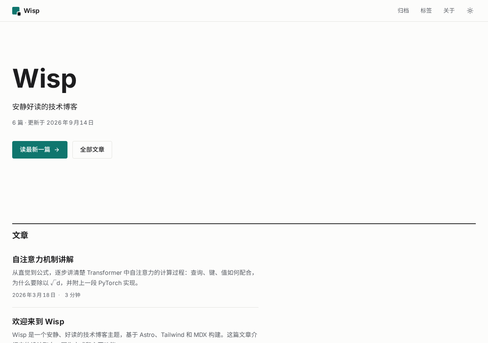
  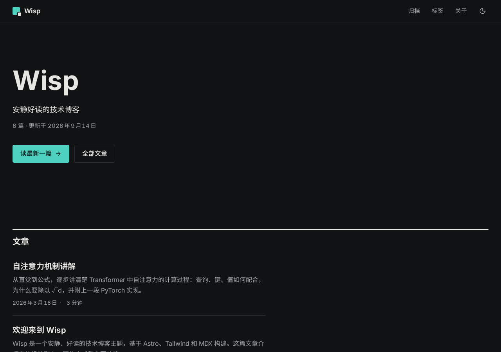
</p>

<p align="center">
  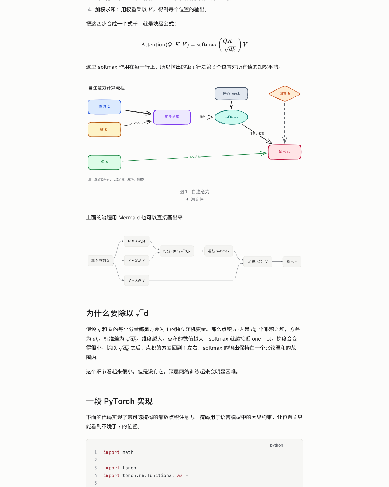
</p>

<p align="center">
  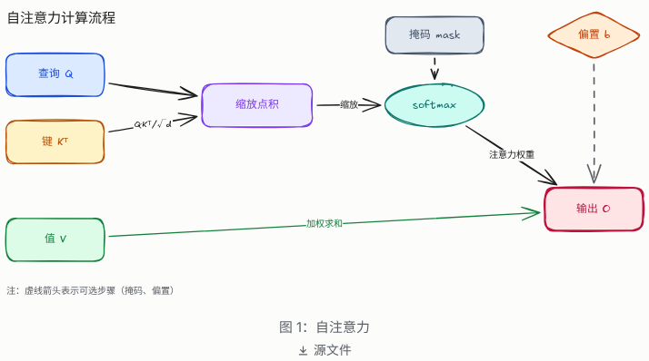
  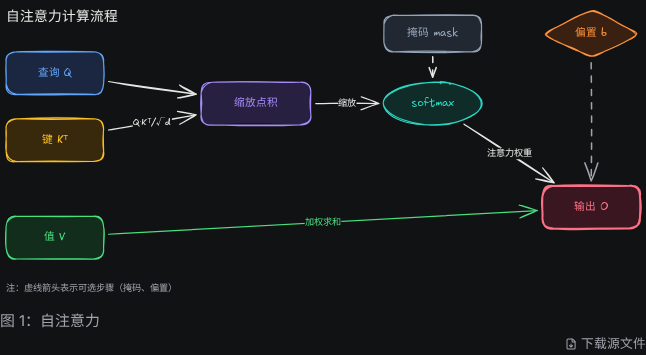
</p>

<p align="center">
  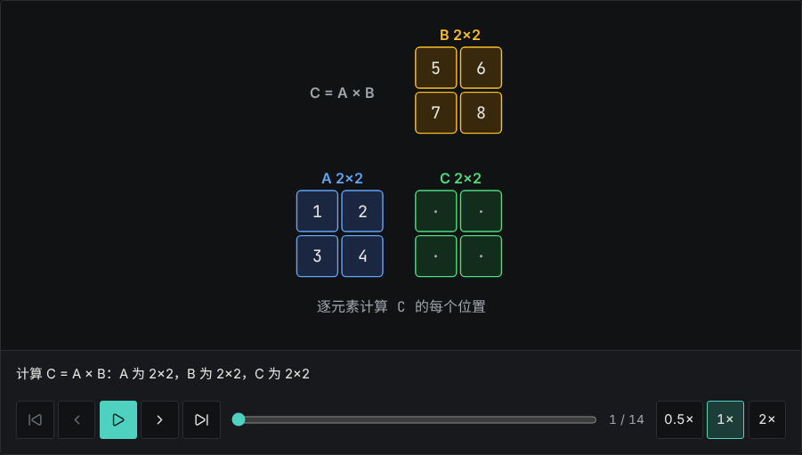
</p>

<p align="center">
  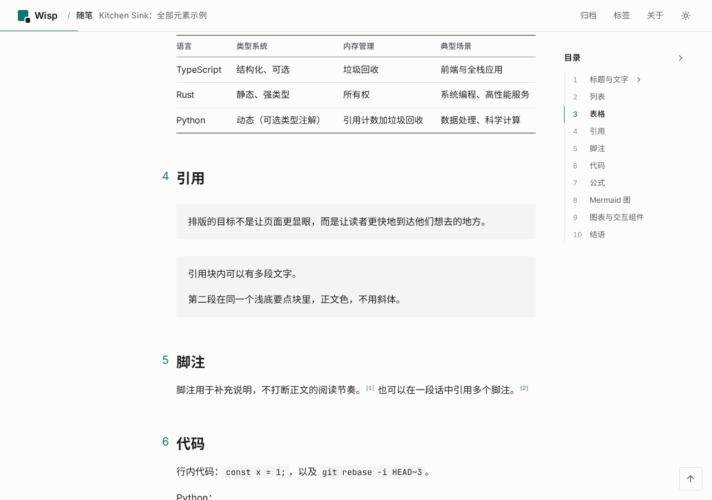
  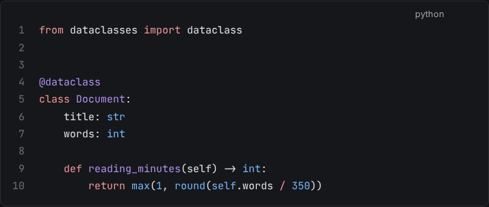
</p>

<p align="center">
  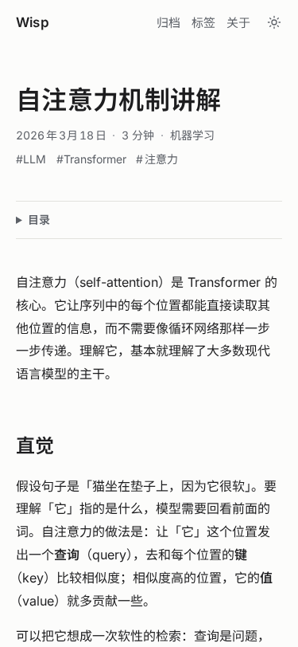
  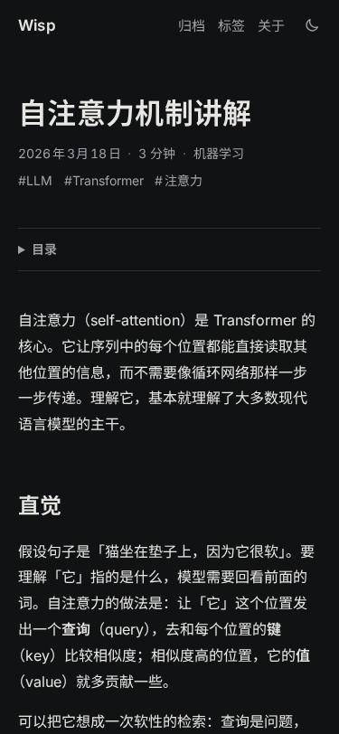
</p>

## 特性

- **Markdown / MDX**：标准 Markdown 与 MDX，脚注、任务列表、表格、标题锚点和目录。
- **公式**：KaTeX，构建期渲染，只有含公式的文章才加载样式。
- **代码**：Shiki 双主题（浅色、深色自动切换），可选行号和一键复制；超过 24 行的代码块默认折叠，可用 `fold` / `nofold` / `fold=N` 单独控制。
- **阅读体验**：宽屏目录可收起并记住状态，h3 分组随阅读位置自动展开；顶部阅读进度条、返回顶部按钮；Lucide 图标（构建期内联）；滚动条随主题配色。
- **Mermaid**：由 [Pele](https://www.npmjs.com/package/pele) 在构建期渲染为内联 SVG，运行时没有 Mermaid.js。
- **图表**：Excalidraw 与 draw.io 源文件经 `wisp diagram build` 生成可移植、可主题化的 `.wisp.svg`，读者可以下载源文件。
- **交互讲解**：通用的分步讲解积木（`Explainer` / `Player` / `Stage` / `Matrix`、`record()` 录制器），React 19 + Motion，以 island 形式按需水合。
- **主题**：浅色、深色、跟随系统三态切换，首屏无闪烁。
- **中文排版**：字体经 Astro 官方 Fonts API 自托管（Inter、JetBrains Mono、Excalifont），思源黑体按 unicode-range 分片、跨页缓存；全部 OFL 授权，不请求第三方字体服务；中英文间距自动处理，不做负字距。
- **订阅与搜索引擎**：RSS（默认全文）、Sitemap。
- **无障碍**：跳转链接、语义化结构、键盘可操作的交互组件、尊重 `prefers-reduced-motion`。
- **可定制、可升级**：主题以 npm 包分发，`pnpm up astro-wisp` 即可升级；通过配置覆盖组件、调色板、样式和路由，不需要改主题源码。
- **少量客户端增强**：主题切换、代码复制和图片 Lightbox 使用小型原生脚本，不加载运行时框架；交互讲解组件才按需加载 React。

## 快速开始

环境要求：**Node.js ≥ 22.23.4** 和 **pnpm**。

**新建站点**（starter 只有配置和内容，主题本身从 npm 安装）：

```bash
pnpm create astro@latest my-blog -- --template xingcanlee/astro-wisp/template
cd my-blog
pnpm dev        # 本地预览，http://localhost:4321
```

**已有 Astro 项目**：

```bash
pnpm astro add astro-wisp
```

然后在 `src/content.config.ts` 中声明内容集合（Astro 的内容集合只能由站点声明，主题提供 loader 和 schema）：

```ts
import { defineCollection } from 'astro:content';
import { pagesLoader, pagesSchema, postsLoader, postsSchema } from 'astro-wisp/content';

export const collections = {
  posts: defineCollection({ loader: postsLoader(), schema: postsSchema() }),
  pages: defineCollection({ loader: pagesLoader(), schema: pagesSchema() }),
};
```

站点项目里只有 `astro.config.ts`、`src/content.config.ts` 和 `src/content/`，以及你自己选择覆盖的组件或样式。主题注入的页面、布局、组件、样式和 Markdown 管线都在 `node_modules/astro-wisp` 里。

更多步骤见 [docs/guide/getting-started.md](docs/guide/getting-started.md)。

## 升级主题

```bash
pnpm up astro-wisp          # 次版本内升级
pnpm add astro-wisp@latest  # 跨大版本，先读 CHANGELOG
```

主题代码不在站点仓库里，所以升级不会和你的修改冲突：你覆盖过的组件、`customCss`、调色板覆盖都保存在站点自己的文件中，其余部分随包更新。版本号遵循 semver，配置项、可覆盖组件名和组件 props 的不兼容改动只出现在大版本。

## 写一篇文章

每篇文章是 `src/content/posts/` 下的一个目录，入口为 `index.mdx`（或 `index.md`）；也可以直接放一个单文件 `<slug>.md`。

```text
src/content/posts/
└─ my-first-post/
   ├─ index.mdx          # 正文
   ├─ diagrams/          # 图表源文件（.excalidraw / .drawio）和生成的 .wisp.svg
   └─ images/            # 图片
```

frontmatter 字段（`astro-wisp/content` 的 `postsSchema()`，可用 `extend` 扩展）：

| 字段 | 类型 | 必填 | 默认值 | 说明 |
|---|---|---|---|---|
| `title` | string（≤ 80 字） | 是 | — | 标题 |
| `description` | string（≤ 200 字） | 是 | — | 摘要，用于列表和 SEO |
| `pubDate` | 日期 | 是 | — | 发布日期 |
| `updatedDate` | 日期 | 否 | — | 更新日期 |
| `tags` | string[] | 否 | `[]` | 标签 |
| `category` | string | 否 | — | 分类 |
| `draft` | boolean | 否 | `false` | 草稿，生产构建中不出现 |
| `featured` | boolean | 否 | `false` | 出现在首页精选 |
| `cover` | 图片 | 否 | — | 封面图 |
| `lang` | string | 否 | — | 文章语言，覆盖站点语言 |
| `toc` | boolean | 否 | `true` | 是否显示目录 |

文章 id 即目录名（`my-first-post`），URL 为 `/posts/my-first-post/`。完整写作说明见 [docs/guide/writing.md](docs/guide/writing.md)。

## 图表

三种图表各有分工：

| 场景 | 方式 | 源文件 |
|---|---|---|
| 流程图、时序图、状态图等结构化图 | Mermaid 代码块 | 无（正文中直接写） |
| 概念图、示意图（手绘风格） | Excalidraw | `*.excalidraw`（JSON） |
| 精确排版的结构图、多页架构图 | draw.io | `*.drawio`（未压缩 XML） |

Mermaid：

````markdown
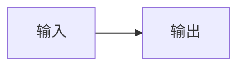
````

Excalidraw 或 draw.io，使用标准图片语法引用源文件：

```markdown


```

- alt 文本写入 SVG 的 `<title>`（无障碍名称），应描述图要表达的结论。
- 引号中的文字成为图注。
- `#page=` 选择 draw.io 的页面，可以用页面名或从 1 开始的序号。
- 页面底部会显示“源文件”下载链接，`.excalidraw` 和 `.drawio` 都可以直接下载后再编辑。

修改源文件后执行：

```bash
pnpm diagram build      # 即 wisp diagram build：增量生成 .wisp.svg，并更新 diagrams.manifest.json
pnpm diagram check      # 只校验哈希，CI 中使用，不需要浏览器
```

`wisp diagram` 转调随主题包分发的 skill 脚本（Python），需要安装 [uv](https://docs.astral.sh/uv/)；构建与导出还需要 Chromium（`uv run --with playwright==1.64.1 playwright install chromium`）。

`.wisp.svg`、源文件和 `diagrams.manifest.json` 都要提交进仓库。图表的完整说明见 [docs/guide/diagrams.md](docs/guide/diagrams.md)，Agent 绘图流程见 [wisp-diagram skill](packages/astro-wisp/skills/wisp-diagram/SKILL.md)。

## 交互组件

`astro-wisp/explainers` 提供分步讲解的通用积木，具体讲解（矩阵乘、排序、注意力……）写在站点里：

- **core**（纯 TS）：`Step<S>` 协议、`record()`（把命令式算法录成时间线）、`focusOf()` / `cellId()`、`formatNumber()`、色调 `Tone`
- **React**：`Explainer`（figure + 标题 + 播放器）、`Player`（播放 / 单步 / 进度 / 速度 / 键盘 / aria-live，中英文界面）、`Stage`（自适应 SVG 舞台）、`Matrix` / `Cell` / `Label`

需要 React：`pnpm astro add react`，再 `pnpm add motion`。在 MDX 中导入自己的组件，加上 `client:visible`：

```mdx
import MatMul from './MatMul';

<MatMul client:visible a={[[1,2],[3,4]]} b={[[5,6],[7,8]]} />
```

演示站的 [矩阵乘法](src/content/posts/matrix-multiplication/) 就是这样写的：`matmul.ts`（算法）+ `MatMul.tsx`（画面）。完整说明见 [docs/guide/explainers.md](docs/guide/explainers.md)。

## 配置

配置写在 `astro.config.ts` 的 `wisp({...})` 中，未写的字段使用默认值；站点的正式域名使用 Astro 自己的 `site` 选项。

```ts
import { defineConfig } from 'astro/config';
import wisp from 'astro-wisp';

export default defineConfig({
  site: 'https://example.com',
  integrations: [wisp({ site: { title: '我的博客', author: '你的名字' } })],
});
```

| 选项 | 类型 | 默认值 | 说明 |
|---|---|---|---|
| `site.title` | string | `Wisp` | 站点标题 |
| `site.description` | string | `安静好读的技术博客` | 站点描述 |
| `site.author` | string | `""` | 作者 |
| `site.lang` | string | `zh-CN` | 站点语言 |
| `nav` | `{label, href}[]` | 归档、标签、关于 | 顶部导航 |
| `social` | `{kind, href, label?}[]` | RSS | 社交链接，`kind` 可选 github、x、mastodon、bluesky、email、rss、link |
| `home.featuredCount` | 整数 ≥ 0 | `3` | 首页精选篇数 |
| `home.pageSize` | 整数 ≥ 1 | `10` | 列表每页篇数 |
| `features.*` | boolean | `true` | `codeCopy`、`lineNumbers`、`math`、`mermaid`、`toc`、`diagramDownload`；`codeFold` 为对象 |
| `mermaid.strict` | boolean | `false` | `true` 时 Mermaid 渲染失败使构建失败 |
| `rss.fullText` | boolean | `true` | RSS 输出全文；`false` 只输出摘要 |
| `taxonomy.slugMap` | Record<string, string> | `{}` | 覆盖标签、分类的 URL 段 |
| `components` | Record<组件名, 路径> | `{}` | 覆盖主题组件或布局，见下文 |
| `customCss` | string[] | `[]` | 追加的样式文件 |
| `palette` | 路径或对象 | — | 覆盖调色板（与默认值深度合并） |
| `routes.*` | boolean | `true` | `home`、`posts`、`archive`、`tags`、`categories`、`about`、`rss`、`notFound` |

数组（如 `nav`、`social`）整体替换，对象逐字段深度合并。非法值会在启动时报错并指出字段路径。完整说明见 [docs/guide/configuration.md](docs/guide/configuration.md)。

## 定制

从轻到重：

1. **调色板**：`palette: './design/palette.json'` 或直接写对象，只写要改的键。集成在构建期生成令牌 CSS，并对对比度不达标的颜色给出警告。
2. **样式**：`customCss: ['./src/styles/custom.css']`。这些文件不进 cascade layer，在主题之后加载，总能覆盖主题；主题样式在 Tailwind 的 `components` / `utilities` 层，所以站点页面里的 Tailwind 工具类（`bg-surface`、`text-muted`……）也能覆盖主题组件。
3. **组件覆盖**：`components: { Footer: './src/components/Footer.astro' }`。覆盖组件可以包装默认实现：

   ```astro
   ---
   import Default from 'astro-wisp/components/Footer.astro';
   ---
   <Default />
   <p class="text-muted">额外的一行</p>
   ```

   可覆盖的名称：`Header`、`Footer`、`PostCard`、`PostMeta`、`Toc`、`TagList`、`Pagination`、`PrevNext`、`ThemeToggle`、`Icon`、`Figure`、`Diagram` 等全部组件，以及布局 `Base`、`Post`、`Page`。写错名称时启动报错并列出可选项。
4. **页面**：`routes: { about: false }` 关掉主题的路由，再在 `src/pages/` 中自己实现。自定义页面可以复用 `astro-wisp/layouts/Base.astro` 等布局，以及 `astro-wisp/utils` 中的 `getPosts()`、`getTags()`。
5. **内容模型**：`postsSchema({ extend: z.object({ series: z.string().optional() }) })` 扩展 frontmatter。

## 命令

站点（starter）中：

| 命令 | 说明 |
|---|---|
| `pnpm dev` / `pnpm build` / `pnpm preview` | Astro 标准命令 |
| `pnpm check` | `astro check` + `wisp diagram check` |
| `pnpm diagram <子命令>` | 即 `wisp diagram`，图表工具，见下表 |

本仓库（主题开发）额外有：

| 命令 | 说明 |
|---|---|
| `pnpm check` | `astro check` + `tsc` + vitest + 对比度检查 + 图表校验（质量门禁） |
| `pnpm test` / `pnpm test:e2e` | vitest 单元测试 / Playwright 端到端测试 |
| `pnpm tokens` | 根据默认调色板重新生成主题包内的令牌 CSS |
| `pnpm contrast` | 检查默认调色板的对比度 |
| `pnpm build:template` | 构建 starter（工作区内链接当前主题源码） |

图表子命令（`wisp diagram`）：

| 子命令 | 说明 |
|---|---|
| `build [路径...] [--force] [--embed-fonts] [--fix] [--drawio cli\|docker\|browser]` | 增量构建源文件为 `.wisp.svg`，更新 `diagrams.manifest.json` |
| `check` | 校验 manifest 哈希是否与源文件一致（CI 用，失败退出码 1） |
| `lint [文件...] [--fix] [--strict]` | 检查颜色、字号、网格、字体、文件大小 |
| `export <文件> [--png] [--theme light\|dark] [--scale 2] [-o out.png] [--transparent]` | 导出 PNG 预览（或发布到不支持 SVG 的平台） |
| `new <skeleton.json> [-o out.excalidraw] [--build]` | 由骨架 JSON 生成 `.excalidraw`，可选立即构建 |
| `probe` | 显示 Chromium、Excalidraw 与 draw.io 导出方式（cli / docker / browser）的探测结果 |
| `cache [status\|warm\|clear]` | 查看、预热（离线使用前）或清空导出资源缓存 `~/.cache/wisp-diagram/` |

## 设计令牌

所有颜色只来自调色板。主题自带的默认调色板是 [`packages/astro-wisp/design/palette.json`](packages/astro-wisp/design/palette.json)，主题包内的 `tokens.css`、Pele 映射、图表的 `--wd-*` 映射、交互组件的色调列表和 Excalidraw/draw.io 素材库都由它生成（`pnpm tokens`）。

站点不需要运行生成命令：用 `wisp({ palette })` 覆盖调色板，集成会在构建期生成令牌。不要手改生成文件，也不要在组件中写十六进制颜色。设计规范见 [docs/design-system.md](docs/design-system.md)。

## 给 AI Agent

本仓库为 AI 编码 Agent 准备了这些材料：

- **[CLAUDE.md](CLAUDE.md)**：Claude Code 读取的项目规则，包括颜色规则、生成文件、中文排版规则和常用命令。
- **[docs/](docs/)**：设计文档，覆盖架构、图表体系、交互组件和任务拆分。`docs/README.md` 是入口。
- **[wisp-diagram](packages/astro-wisp/skills/wisp-diagram/)**：一个独立的 Agent skill，用于产出符合 Wisp 风格的 Excalidraw / draw.io 图表。脚本是 Python + uv（PEP 723 内联依赖），`uv run` 即可运行；不依赖 Wisp 站点，可以复制到其他项目使用。
- **[wisp-writer](packages/astro-wisp/skills/wisp-writer/)**：写作 skill。提供写作规范、5 种文章模板、`new_post.py`（新建文章）和 `check_post.py`（检查 frontmatter、标题层级、alt、图表引用、半角标点等），让 Agent 写出风格一致的文章。

两个 skill 随主题包分发，站点里运行 `pnpm exec wisp skills` 可以看到它们在 `node_modules/astro-wisp/skills/` 下的路径，starter 的 `CLAUDE.md` 已经指向它们，随主题一起升级。也可以复制到用户级 skills 目录：

```bash
mkdir -p ~/.claude/skills
cp -r node_modules/astro-wisp/skills/wisp-diagram ~/.claude/skills/
```

也可以复制到其他项目的 `.claude/skills/` 下。skill 的脚本用 Python 编写、依赖写在脚本头部（PEP 723），只要装了 [uv](https://docs.astral.sh/uv/) 就能直接运行，无需安装步骤：

```bash
uv run ~/.claude/skills/wisp-diagram/scripts/wisp_diagram.py --help
uv run --with playwright==1.64.1 playwright install chromium   # 导出用的浏览器，装过可跳过
```

首次导出时会把锁定版本的 Excalidraw、svgo 和字体下载到 `~/.cache/wisp-diagram/`，之后可离线使用（详见 skill 的 SKILL.md）。

## 项目结构

```text
astro-wisp/                      # pnpm 工作区
├─ packages/astro-wisp/          # 主题包（npm: astro-wisp）
│  ├─ index.ts                   #   集成入口 wisp()
│  ├─ src/routes/                #   注入的页面（injectRoute）
│  ├─ src/layouts/ src/components/   # 可覆盖的布局与组件
│  ├─ src/plugins/ src/lib/      #   remark/rehype 插件、图表渲染
│  ├─ src/styles/ src/tokens/    #   样式（分层）与令牌生成
│  ├─ src/explainers/            #   分步讲解积木（astro-wisp/explainers）
│  ├─ design/palette.json        #   默认调色板（唯一来源）
│  ├─ bin/ scripts/              #   wisp CLI（diagram）与维护脚本
│  └─ skills/                    #   wisp-diagram、wisp-writer（随包分发）
├─ template/                     # starter：只有配置和内容，依赖 astro-wisp
├─ src/content/                  # 演示站内容（根目录就是一个使用主题的站点）
├─ tests/e2e/                    # Playwright
└─ docs/                         # 设计文档；docs/guide/ 为使用指南
```

## 技术栈

Astro 7（Node ≥ 22.23.4）· MDX 8 · React 19 · Tailwind CSS 4 · Pele 1.13（Mermaid）· KaTeX 0.19 · Motion 14 · Shiki。图表工具是 Python 脚本，用 uv 运行，导出依赖 Playwright Chromium，可选 draw.io desktop 或 Docker。架构说明见 [docs/architecture.md](docs/architecture.md)，依赖列表见 [packages/astro-wisp/package.json](packages/astro-wisp/package.json)。

## 文档

- [快速开始](docs/guide/getting-started.md)
- [写作指南](docs/guide/writing.md)
- [图表指南](docs/guide/diagrams.md)
- [交互组件](docs/guide/explainers.md)
- [配置参考](docs/guide/configuration.md)
- [部署](docs/guide/deployment.md)

## 许可证

[MIT](https://opensource.org/licenses/MIT)
